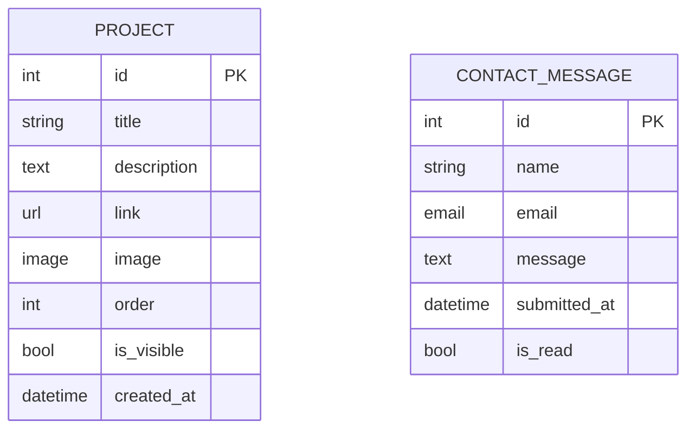

# 🌐 Smooth Scroll Interactive Django Portfolio — Implementation Plan

> **One-line summary:** A clean, single-page Django portfolio where projects and contact data are dynamically managed through the admin panel, enhanced with smooth scroll, fade-in animations, and responsive design.

---

## 📋 Table of Contents

1. [Project Overview](#1-project-overview)
2. [Tech Stack](#2-tech-stack)
3. [Project Structure](#3-project-structure)
4. [Phase 1 — Django Setup & Configuration](#4-phase-1--django-setup--configuration)
5. [Phase 2 — Database Models](#5-phase-2--database-models)
6. [Phase 3 — Admin Panel](#6-phase-3--admin-panel)
7. [Phase 4 — Views & URLs](#7-phase-4--views--urls)
8. [Phase 5 — Base Template & Layout](#8-phase-5--base-template--layout)
9. [Phase 6 — Section Templates](#9-phase-6--section-templates)
10. [Phase 7 — Responsive Design](#10-phase-7--responsive-design)
11. [Phase 8 — Immersive Motions & Animations](#11-phase-8--immersive-motions--animations)
12. [Phase 9 — Contact Form Backend](#12-phase-9--contact-form-backend)
13. [Phase 10 — Polish & Deployment Prep](#13-phase-10--polish--deployment-prep)
14. [Design System](#14-design-system)
15. [Database Schema](#15-database-schema)
16. [File-by-File Breakdown](#16-file-by-file-breakdown)
17. [Potential Errors & Troubleshooting](#17-potential-errors--troubleshooting)

---

## 1. Project Overview

### 🎯 Goal

Build a **single-page Django portfolio website** that:

- Dynamically loads **projects** from the database
- Stores **contact form** submissions in the database
- Features **smooth scrolling**, **fade-in animations**, and **hover effects**
- Is fully **responsive** (mobile-first design)
- Can be managed entirely through the **Django admin panel**

### 🧱 Sections

| Section   | Content                                      | Dynamic? |
|-----------|----------------------------------------------|----------|
| **Home**  | Name, Role, One-liner intro                  | Static (template) |
| **About** | 3–4 lines + skills list                      | Static (template) or Dynamic (model) |
| **Projects** | Title, Description, Link — card layout    | ✅ Database |
| **Contact** | Name, Email, Message form                  | ✅ Database |

---

## 2. Tech Stack

### Backend

| Tool             | Purpose                         |
|------------------|---------------------------------|
| **Python 3.11+** | Language                        |
| **Django 5.x**   | Web framework                   |
| **SQLite**       | Database (dev) — easy, no setup |
| **Django Admin**  | Content management              |

### Frontend

| Tool                  | Purpose                              |
|-----------------------|--------------------------------------|
| **HTML5**             | Structure                            |
| **CSS3**              | Styling, animations, responsive      |
| **Vanilla JavaScript**| Smooth scroll, fade-in, interactions |
| **Google Fonts**      | Typography (Inter / Outfit)          |

### Optional Libraries (Lightweight)

| Library        | Purpose                    | Required? |
|----------------|----------------------------|-----------|
| **AOS.js**     | Animate on Scroll          | Optional  |
| **GSAP**       | Smoother animations        | Optional  |

> [!TIP]
> We'll implement all animations with **pure CSS + vanilla JS first**. AOS/GSAP can be added later if needed.

---

## 3. Project Structure

```
portfolio/
├── manage.py
├── requirements.txt
├── .gitignore
├── db.sqlite3
│
├── portfolio_project/              # Django project config
│   ├── __init__.py
│   ├── settings.py
│   ├── urls.py
│   ├── wsgi.py
│   └── asgi.py
│
├── core/                           # Main app
│   ├── __init__.py
│   ├── admin.py                    # Admin panel config
│   ├── apps.py
│   ├── models.py                   # Project + Contact models
│   ├── views.py                    # Single page view
│   ├── urls.py                     # App-level URLs
│   ├── forms.py                    # Contact form
│   └── migrations/
│       └── __init__.py
│
├── templates/                      # HTML templates
│   ├── base.html                   # Base layout (nav, footer, scripts)
│   └── core/
│       └── index.html              # Main single page
│
└── static/                         # Static assets
    ├── css/
    │   └── style.css               # All styles
    ├── js/
    │   └── main.js                 # All scripts
    └── images/
        └── (profile pic, favicon, etc.)
```

---

## 4. Phase 1 — Django Setup & Configuration

### Steps

1. **Create virtual environment**
   ```bash
   python -m venv venv
   venv\Scripts\activate          # Windows
   ```

2. **Install Django**
   ```bash
   pip install django
   pip freeze > requirements.txt
   ```

3. **Create Django project**
   ```bash
   django-admin startproject portfolio_project .
   ```
   > [!IMPORTANT]
   > The `.` at the end creates the project in the current directory (no nested folder).

4. **Create the `core` app**
   ```bash
   python manage.py startapp core
   ```

5. **Register the app** in `portfolio_project/settings.py`:
   ```python
   INSTALLED_APPS = [
       # ...
       'core',
   ]
   ```

6. **Configure static & template directories** in `settings.py`:
   ```python
   import os

   TEMPLATES = [
       {
           # ...
           'DIRS': [os.path.join(BASE_DIR, 'templates')],
           # ...
       },
   ]

   STATIC_URL = '/static/'
   STATICFILES_DIRS = [os.path.join(BASE_DIR, 'static')]
   STATIC_ROOT = os.path.join(BASE_DIR, 'staticfiles')
   ```

7. **Create directories**
   ```bash
   mkdir templates templates\core static static\css static\js static\images
   ```

8. **Run initial migration & test**
   ```bash
   python manage.py migrate
   python manage.py runserver
   ```

> [!NOTE]
> At this point, visiting `http://127.0.0.1:8000` should show the Django welcome page.

---

## 5. Phase 2 — Database Models

### File: `core/models.py`

```python
from django.db import models
from django.utils import timezone


class Project(models.Model):
    title = models.CharField(max_length=200)
    description = models.TextField()
    link = models.URLField(blank=True, null=True)
    image = models.ImageField(upload_to='projects/', blank=True, null=True)
    order = models.IntegerField(default=0, help_text="Lower number = shown first")
    is_visible = models.BooleanField(default=True)
    created_at = models.DateTimeField(default=timezone.now)

    class Meta:
        ordering = ['order', '-created_at']

    def __str__(self):
        return self.title


class ContactMessage(models.Model):
    name = models.CharField(max_length=100)
    email = models.EmailField()
    message = models.TextField()
    submitted_at = models.DateTimeField(auto_now_add=True)
    is_read = models.BooleanField(default=False)

    class Meta:
        ordering = ['-submitted_at']

    def __str__(self):
        return f"{self.name} — {self.email} ({self.submitted_at:%Y-%m-%d})"
```

### Key Design Decisions

| Field              | Why                                                  |
|--------------------|------------------------------------------------------|
| `order`            | Control display order from admin (drag-sort friendly) |
| `is_visible`       | Hide projects without deleting                       |
| `image` (optional) | Allow project thumbnails if desired                  |
| `is_read`          | Track which contact messages you've read              |

### Migrations

```bash
pip install Pillow           # Required for ImageField
pip freeze > requirements.txt
python manage.py makemigrations core
python manage.py migrate
```

---

## 6. Phase 3 — Admin Panel

### File: `core/admin.py`

```python
from django.contrib import admin
from .models import Project, ContactMessage


@admin.register(Project)
class ProjectAdmin(admin.ModelAdmin):
    list_display = ('title', 'order', 'is_visible', 'created_at')
    list_editable = ('order', 'is_visible')
    list_filter = ('is_visible',)
    search_fields = ('title', 'description')


@admin.register(ContactMessage)
class ContactMessageAdmin(admin.ModelAdmin):
    list_display = ('name', 'email', 'submitted_at', 'is_read')
    list_editable = ('is_read',)
    list_filter = ('is_read', 'submitted_at')
    search_fields = ('name', 'email', 'message')
    readonly_fields = ('name', 'email', 'message', 'submitted_at')

    def has_add_permission(self, request):
        return False  # Messages come from the site, not admin
```

### Create Superuser

```bash
python manage.py createsuperuser
```

> [!TIP]
> After this, you can log into `http://127.0.0.1:8000/admin/` and start adding projects!

---

## 7. Phase 4 — Views & URLs

### File: `core/forms.py`

```python
from django import forms
from .models import ContactMessage


class ContactForm(forms.ModelForm):
    class Meta:
        model = ContactMessage
        fields = ['name', 'email', 'message']
        widgets = {
            'name': forms.TextInput(attrs={
                'placeholder': 'Your Name',
                'id': 'contact-name',
                'autocomplete': 'name',
            }),
            'email': forms.EmailInput(attrs={
                'placeholder': 'your@email.com',
                'id': 'contact-email',
                'autocomplete': 'email',
            }),
            'message': forms.Textarea(attrs={
                'placeholder': 'Your message...',
                'rows': 5,
                'id': 'contact-message',
            }),
        }
```

### File: `core/views.py`

```python
from django.shortcuts import render, redirect
from django.contrib import messages
from .models import Project
from .forms import ContactForm


def index(request):
    projects = Project.objects.filter(is_visible=True)
    
    if request.method == 'POST':
        form = ContactForm(request.POST)
        if form.is_valid():
            form.save()
            messages.success(request, 'Thank you! Your message has been sent.')
            return redirect('home')
    else:
        form = ContactForm()

    context = {
        'projects': projects,
        'form': form,
    }
    return render(request, 'core/index.html', context)
```

### File: `core/urls.py`

```python
from django.urls import path
from . import views

urlpatterns = [
    path('', views.index, name='home'),
]
```

### File: `portfolio_project/urls.py`

```python
from django.contrib import admin
from django.urls import path, include
from django.conf import settings
from django.conf.urls.static import static

urlpatterns = [
    path('admin/', admin.site.urls),
    path('', include('core.urls')),
]

if settings.DEBUG:
    urlpatterns += static(settings.MEDIA_URL, document_root=settings.MEDIA_ROOT)
```

### Add to `settings.py`

```python
MEDIA_URL = '/media/'
MEDIA_ROOT = os.path.join(BASE_DIR, 'media')
```

---

## 8. Phase 5 — Base Template & Layout

### File: `templates/base.html`

```html

<!DOCTYPE html>
<html lang="en">
<head>
    <meta charset="UTF-8">
    <meta name="viewport" content="width=device-width, initial-scale=1.0">
    <meta name="description" content="Portfolio of [Your Name] — Web Developer & AI Student">
    <title>Portfolio — [Your Name]</title>
    
    <!-- Google Fonts -->
    <link rel="preconnect" href="https://fonts.googleapis.com">
    <link rel="preconnect" href="https://fonts.gstatic.com" crossorigin>
    <link href="https://fonts.googleapis.com/css2?family=Inter:wght@300;400;500;600;700&display=swap" rel="stylesheet">
    
    <!-- Stylesheet -->
    <link rel="stylesheet" href="">
</head>
<body>
    <!-- Navigation -->
    <nav class="navbar" id="navbar">
        <div class="nav-container">
            <a href="#home" class="nav-logo">Portfolio</a>
            <button class="hamburger" id="hamburger" aria-label="Toggle menu">
                <span></span>
                <span></span>
                <span></span>
            </button>
            <ul class="nav-links" id="nav-links">
                <li><a href="#home" class="nav-link active">Home</a></li>
                <li><a href="#about" class="nav-link">About</a></li>
                <li><a href="#projects" class="nav-link">Projects</a></li>
                <li><a href="#contact" class="nav-link">Contact</a></li>
            </ul>
        </div>
    </nav>

    <!-- Messages (Django) -->
    
    <div class="messages-container" id="messages-container">
        
        <div class="alert alert-{{ message.tags }}">
            {{ message }}
            <button class="alert-close" onclick="this.parentElement.remove()">×</button>
        </div>
        
    </div>
    

    <!-- Page Content -->
    <main>
        
    </main>

    <!-- Footer -->
    <footer class="footer">
        <p>&copy; {{ year }} [Your Name]. All rights reserved.</p>
    </footer>

    <!-- Scripts -->
    <script src=""></script>
</body>
</html>
```

---

## 9. Phase 6 — Section Templates

### File: `templates/core/index.html`

```html





<!-- ===== HOME SECTION ===== -->
<section id="home" class="section hero-section">
    <div class="hero-content fade-in">
        <p class="hero-greeting">Hello, I'm</p>
        <h1 class="hero-name">[Your Name]</h1>
        <p class="hero-role">Web Developer | AI Student</p>
        <p class="hero-tagline">Building elegant solutions with code & creativity.</p>
        <a href="#projects" class="btn btn-primary">View My Work</a>
    </div>
    <div class="hero-bg-effect"></div>
</section>

<!-- ===== ABOUT SECTION ===== -->
<section id="about" class="section about-section">
    <div class="container">
        <h2 class="section-title fade-in">About Me</h2>
        <div class="about-content fade-in">
            <p>
                I'm a passionate web developer and AI student who loves turning ideas 
                into clean, functional digital experiences. I enjoy exploring both 
                frontend aesthetics and backend logic.
            </p>
            <p>
                When I'm not coding, you'll find me exploring new technologies, 
                contributing to open source, or learning about the latest in AI.
            </p>
        </div>
        <div class="skills-list fade-in">
            <h3>Skills</h3>
            <ul>
                <li>Python &amp; Django</li>
                <li>HTML, CSS, JavaScript</li>
                <li>Machine Learning Basics</li>
                <li>Git &amp; GitHub</li>
                <li>REST APIs</li>
                <li>SQL &amp; Database Design</li>
            </ul>
        </div>
    </div>
</section>

<!-- ===== PROJECTS SECTION ===== -->
<section id="projects" class="section projects-section">
    <div class="container">
        <h2 class="section-title fade-in">Projects</h2>
        <div class="projects-grid">
            
            <div class="project-card fade-in">
                
                <div class="project-image">
                    
                </div>
                
                <div class="project-info">
                    <h3 class="project-title">{{ project.title }}</h3>
                    <p class="project-description">{{ project.description }}</p>
                    
                    <a href="{{ project.link }}" target="_blank" rel="noopener noreferrer" 
                       class="btn btn-outline">View Project →</a>
                    
                </div>
            </div>
            
            <p class="no-projects">Projects coming soon! 🚀</p>
            
        </div>
    </div>
</section>

<!-- ===== CONTACT SECTION ===== -->
<section id="contact" class="section contact-section">
    <div class="container">
        <h2 class="section-title fade-in">Get In Touch</h2>
        <p class="contact-subtitle fade-in">Have a question or want to work together? Drop me a message!</p>
        <form method="POST" class="contact-form fade-in" id="contact-form">
            
            
            <div class="form-group">
                {{ field }}
                
                <span class="form-error">{{ field.errors.0 }}</span>
                
            </div>
            
            <button type="submit" class="btn btn-primary" id="contact-submit">Send Message</button>
        </form>
    </div>
</section>


```

---

## 10. Phase 7 — Responsive Design

### Strategy: Mobile-First

```
┌─────────────────────────────────────┐
│         BREAKPOINTS                 │
├─────────────────────────────────────┤
│  Default     → Mobile (< 768px)    │
│  @768px      → Tablet              │
│  @1024px     → Desktop             │
│  @1200px     → Large Desktop       │
└─────────────────────────────────────┘
```

### Key Responsive Behaviors

| Element        | Mobile            | Tablet            | Desktop              |
|----------------|-------------------|-------------------|----------------------|
| **Navbar**     | Hamburger menu    | Hamburger menu    | Horizontal links     |
| **Hero**       | Centered, stacked | Centered, stacked | Centered, larger     |
| **Projects**   | 1 column          | 2 columns         | 3 columns            |
| **Contact**    | Full width form   | 80% width form    | 60% width form       |
| **Font sizes** | Smaller           | Medium            | Larger               |

### CSS Approach

```css
/* Mobile first - default styles for small screens */
.projects-grid {
    display: grid;
    grid-template-columns: 1fr;
    gap: 2rem;
}

/* Tablet */
@media (min-width: 768px) {
    .projects-grid {
        grid-template-columns: repeat(2, 1fr);
    }
}

/* Desktop */
@media (min-width: 1024px) {
    .projects-grid {
        grid-template-columns: repeat(3, 1fr);
    }
}
```

### Hamburger Menu Behavior

```
Mobile View:
┌──────────────────────┐
│ Logo          ☰      │   ← Hamburger icon
├──────────────────────┤
│ Home                 │   ← Slides down on click
│ About                │
│ Projects             │
│ Contact              │
└──────────────────────┘

Desktop View:
┌──────────────────────────────────────────┐
│ Logo      Home  About  Projects  Contact │
└──────────────────────────────────────────┘
```

---

## 11. Phase 8 — Immersive Motions & Animations

### 🌊 1. Smooth Scrolling

**How:** CSS `scroll-behavior` + JS for navbar clicks

```css
html {
    scroll-behavior: smooth;
}
```

```javascript
// Smooth scroll to section on nav click
document.querySelectorAll('a[href^="#"]').forEach(anchor => {
    anchor.addEventListener('click', function (e) {
        e.preventDefault();
        const target = document.querySelector(this.getAttribute('href'));
        target.scrollIntoView({ behavior: 'smooth', block: 'start' });
    });
});
```

---

### 🎭 2. Fade-in on Scroll (Intersection Observer)

**How:** Pure JavaScript Intersection Observer API (no library needed)

```javascript
const observer = new IntersectionObserver((entries) => {
    entries.forEach(entry => {
        if (entry.isIntersecting) {
            entry.target.classList.add('visible');
        }
    });
}, { threshold: 0.1 });

document.querySelectorAll('.fade-in').forEach(el => observer.observe(el));
```

```css
.fade-in {
    opacity: 0;
    transform: translateY(30px);
    transition: opacity 0.6s ease-out, transform 0.6s ease-out;
}

.fade-in.visible {
    opacity: 1;
    transform: translateY(0);
}
```

---

### 🧩 3. Project Card Hover Effects

```css
.project-card {
    transition: transform 0.3s ease, box-shadow 0.3s ease;
}

.project-card:hover {
    transform: translateY(-8px) scale(1.02);
    box-shadow: 0 20px 40px rgba(0, 0, 0, 0.15);
}
```

---

### 🖱️ 4. Button Micro-Interactions

```css
.btn {
    transition: all 0.3s ease;
}

.btn:hover {
    transform: translateY(-2px);
    box-shadow: 0 5px 15px rgba(99, 102, 241, 0.4);
}

.btn:active {
    transform: scale(0.97);
}
```

---

### 🌌 5. Subtle Background Gradient Animation

```css
.hero-section {
    background: linear-gradient(-45deg, #0f0c29, #302b63, #24243e, #0f0c29);
    background-size: 400% 400%;
    animation: gradientShift 15s ease infinite;
}

@keyframes gradientShift {
    0% { background-position: 0% 50%; }
    50% { background-position: 100% 50%; }
    100% { background-position: 0% 50%; }
}
```

---

### 📊 Animation Summary

| Animation            | Technique                  | Performance |
|----------------------|----------------------------|-------------|
| Smooth scroll        | CSS + JS                   | ✅ Excellent |
| Fade-in on scroll    | Intersection Observer + CSS | ✅ Excellent |
| Card hover           | CSS transform              | ✅ Excellent |
| Button interactions  | CSS transition             | ✅ Excellent |
| Gradient background  | CSS animation              | ✅ Excellent |

> [!NOTE]
> All animations use GPU-accelerated properties (`transform`, `opacity`) for smooth 60fps performance.

---

## 12. Phase 9 — Contact Form Backend

### Flow

```
User fills form → POST request → Django validates → Save to DB → Redirect with success message
```

### Validation (handled by Django ModelForm)

- **Name**: Required, max 100 chars
- **Email**: Required, valid email format
- **Message**: Required, no max limit

### Success Feedback

Django `messages` framework shows a toast-style notification:

```python
messages.success(request, 'Thank you! Your message has been sent.')
```

### Viewing Messages

Admin panel → Contact Messages → See all messages with read/unread status.

---

## 13. Phase 10 — Polish & Deployment Prep

### Checklist

- [ ] Replace all `[Your Name]` placeholders with actual content
- [ ] Add a favicon
- [ ] Add profile picture to hero section (optional)
- [ ] Add at least 3 sample projects via admin
- [ ] Test responsive design on multiple devices
- [ ] Test contact form submission
- [ ] Add `DEBUG = False` for production
- [ ] Set `ALLOWED_HOSTS`
- [ ] Collect static files: `python manage.py collectstatic`
- [ ] Set up `CSRF_TRUSTED_ORIGINS` if deploying

### Deployment Options

| Platform       | Ease  | Free Tier? | Notes                    |
|----------------|-------|------------|--------------------------|
| **Railway**    | ⭐⭐⭐  | ✅          | Best for Django          |
| **Render**     | ⭐⭐⭐  | ✅          | Free tier available      |
| **PythonAnywhere** | ⭐⭐⭐⭐ | ✅     | Easiest for beginners    |
| **Vercel**     | ⭐⭐   | ✅          | Possible but not ideal   |
| **Heroku**     | ⭐⭐⭐  | ❌          | No longer free           |

### Production Dependencies

```bash
pip install gunicorn whitenoise
```

Add to `settings.py`:
```python
MIDDLEWARE = [
    'django.middleware.security.SecurityMiddleware',
    'whitenoise.middleware.WhiteNoiseMiddleware',  # Add after SecurityMiddleware
    # ...
]

STATICFILES_STORAGE = 'whitenoise.storage.CompressedManifestStaticFilesStorage'
```

---

## 14. Design System

### Color Palette

```
┌─────────────────────────────────────────────┐
│  DARK THEME (Primary)                       │
├─────────────────────────────────────────────┤
│  Background:     #0a0a0f  (Deep dark)       │
│  Surface:        #13131a  (Card background)  │
│  Surface Hover:  #1a1a25  (Elevated)         │
│  Border:         #2a2a3d  (Subtle borders)   │
│                                              │
│  Text Primary:   #f0f0f5  (White-ish)        │
│  Text Secondary: #9494a8  (Muted)            │
│  Text Accent:    #c4b5fd  (Soft purple)      │
│                                              │
│  Primary:        #6366f1  (Indigo)            │
│  Primary Hover:  #818cf8  (Light Indigo)      │
│  Primary Glow:   rgba(99,102,241,0.3)        │
│                                              │
│  Accent:         #8b5cf6  (Purple)            │
│  Success:        #10b981  (Green)             │
│  Error:          #ef4444  (Red)               │
└─────────────────────────────────────────────┘
```

### Typography

```
Font Family:  'Inter', sans-serif
Weights:      300 (Light), 400 (Regular), 500 (Medium), 600 (Semi-bold), 700 (Bold)

Sizes:
  Hero Name:    clamp(2.5rem, 5vw, 4rem)
  Section Title: clamp(1.8rem, 3vw, 2.5rem)
  Body:          1rem (16px)
  Small:         0.875rem (14px)
```

### Spacing Scale

```
--space-xs:   0.5rem    (8px)
--space-sm:   1rem      (16px)
--space-md:   1.5rem    (24px)
--space-lg:   2rem      (32px)
--space-xl:   3rem      (48px)
--space-2xl:  4rem      (64px)
--space-3xl:  6rem      (96px)
```

### Border Radius

```
--radius-sm:  0.5rem    (8px)   — buttons, inputs
--radius-md:  0.75rem   (12px)  — cards
--radius-lg:  1rem      (16px)  — modals
--radius-full: 9999px            — pills, avatars
```

---

## 15. Database Schema



### Data Flow

```mermaid
flowchart LR
    A[Admin Panel] -->|Add/Edit| B[Project Table]
    B -->|Query visible| C[Django View]
    C -->|Render| D[Template]
    D -->|Display| E[Browser]
    
    F[User] -->|Submit Form| G[Contact Form]
    G -->|POST| H[Django View]
    H -->|Validate & Save| I[ContactMessage Table]
    I -->|View| A
```



---

## 16. File-by-File Breakdown

### Implementation Order

| #  | File                            | What to Build                           | Depends On |
|----|---------------------------------|-----------------------------------------|------------|
| 1  | `settings.py`                   | Config: apps, templates, static, media  | —          |
| 2  | `core/models.py`                | Project + ContactMessage models         | Step 1     |
| 3  | `core/admin.py`                 | Admin panel configuration               | Step 2     |
| 4  | `core/forms.py`                 | ContactForm                             | Step 2     |
| 5  | `core/views.py`                 | `index` view (GET + POST)              | Steps 2–4  |
| 6  | `core/urls.py`                  | App URL patterns                        | Step 5     |
| 7  | `portfolio_project/urls.py`     | Root URL config + media                 | Step 6     |
| 8  | `templates/base.html`           | Base layout, nav, footer                | Step 1     |
| 9  | `templates/core/index.html`     | All 4 sections                          | Steps 5, 8 |
| 10 | `static/css/style.css`          | Full responsive stylesheet              | Step 9     |
| 11 | `static/js/main.js`             | Animations, hamburger, scroll           | Step 9     |

---

## 17. Potential Errors & Troubleshooting

### Common Issues

| Error | Cause | Fix |
|-------|-------|-----|
| `TemplateDoesNotExist` | Wrong template path | Check `DIRS` in settings + file location |
| `ModuleNotFoundError: PIL` | Pillow not installed | `pip install Pillow` |
| `CSRF token missing` | Forgot `` in form | Add the tag inside `<form>` |
| Static files not loading | Not using `` | Add at top of template |
| Static files 404 in production | Didn't run collectstatic | `python manage.py collectstatic` |
| Images not showing | `MEDIA_URL` not configured | Add media URL config + urlpatterns |
| Admin login redirect loop | `LOGIN_URL` misconfigured | Check `settings.py` |
| Hamburger menu not working | JS error | Check console for errors |
| Animations janky | Using `width`/`height` transitions | Use `transform` + `opacity` only |

### Debug Checklist

```
✅ python manage.py check           — Django system check
✅ python manage.py showmigrations   — Verify migrations applied
✅ python manage.py shell            — Test queries
✅ Browser DevTools (F12)            — Check CSS/JS errors
✅ Network tab                       — Verify static file loading
✅ Responsive mode                   — Test different screen sizes
```

---

## 🚀 Quick Start Summary

```bash
# 1. Setup
python -m venv venv && venv\Scripts\activate
pip install django Pillow

# 2. Create project
django-admin startproject portfolio_project .
python manage.py startapp core

# 3. Configure settings.py (apps, templates, static, media)
# 4. Create models → makemigrations → migrate
# 5. Setup admin → createsuperuser
# 6. Build views, urls, forms
# 7. Create templates (base.html, index.html)
# 8. Write CSS (responsive, dark theme, animations)
# 9. Write JS (smooth scroll, fade-in, hamburger)
# 10. Add projects via admin
# 11. Test everything
# 12. Deploy!
```

> [!IMPORTANT]
> **Start building from Phase 1 and go sequentially.** Each phase builds on the previous one. Don't skip ahead!

---

*Generated on 2026-03-24 · Django 5.x · Mobile-First · Dark Theme · Smooth Animations*
